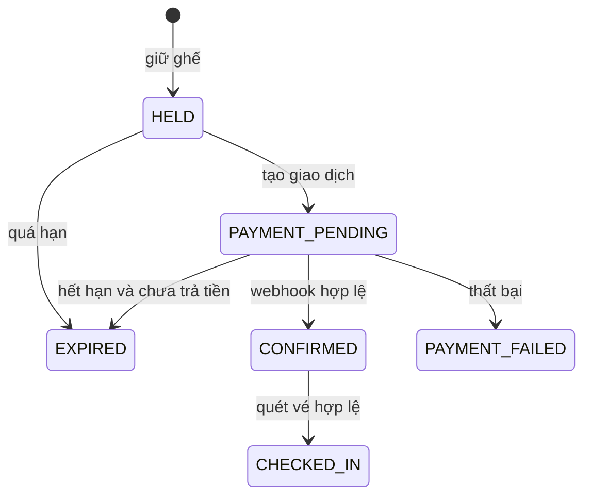

# Kế hoạch dự án đặt vé xem phim và kiểm định chất lượng

## 1. Mục tiêu và giả định

Xây dựng **CinemaBooking**, một ứng dụng web responsive cho một cụm rạp, đồng thời tạo hồ sơ đánh giá và kiểm định chất lượng có thể tái lập như StudySpace. Kết quả cuối gồm sản phẩm chạy được, mã nguồn, test tự động, báo cáo lỗi, ma trận truy vết và bằng chứng gắn với đúng commit. Mọi kết luận “đạt” chỉ áp dụng cho môi trường và kịch bản đã đo.

Giả định gốc của kế hoạch là nhóm 2 người, 10 tuần, khoảng 12–15 giờ/người/tuần; tiền tệ VND; múi giờ nghiệp vụ `Asia/Ho_Chi_Minh`. Kế hoạch ban đầu giả định staging, nhưng môi trường hiện được xác nhận chỉ là Docker local; vì vậy không đánh dấu các gate staging/production là đạt. Thanh toán hiện là **mock** qua adapter, không nhận hay lưu dữ liệu thẻ. Hủy/hoàn tiền thuộc P1/ngoài acceptance P0; phân loại độ tuổi và chính sách pháp lý chưa được phê duyệt.

### Tiêu chí thành công

1. Khách xem phim, rạp, suất chiếu và ghế; người dùng đăng nhập giữ ghế, thanh toán mock và nhận vé QR; nhân viên quét vé; quản trị viên vận hành và xem báo cáo.
2. Không có hai vé hợp lệ cho cùng `showtimeId + seatId`, kể cả khi nhiều request hoặc webhook đến đồng thời.
3. Các chuyển trạng thái đặt vé, giữ ghế, mock payment và soát vé tuân theo bảng trạng thái đã phê duyệt; callback thanh toán muộn được ghi reconciliation thủ công. Hủy/hoàn tiền không thuộc P0; request lặp không tạo giao dịch mới.
4. Mọi yêu cầu quan trọng có ít nhất một test và evidence; các đường đi lỗi và biên được kiểm tra trước khi tuyên bố hoàn thành.
5. Bản nộp giải thích rõ kết quả thực chạy, lỗi còn tồn tại và phạm vi chưa đánh giá; không dùng coverage hoặc scanner pass để thay thế đánh giá nghiệp vụ.

## 2. Phạm vi sản phẩm

| Mức | Chức năng | Điều kiện hoàn thành |
|---|---|---|
| P0 — bắt buộc | Đăng ký/đăng nhập, hồ sơ, phân quyền `CUSTOMER`/`STAFF`/`ADMIN` | Quyền được kiểm tra ở API và theo từng đối tượng |
| P0 — bắt buộc | Danh mục phim, rạp, phòng, sơ đồ ghế, suất chiếu | Lọc theo ngày/rạp/phim; chỉ công bố suất hợp lệ |
| P0 — bắt buộc | Chọn 1–8 ghế cùng suất, giữ ghế 5 phút, hết hạn giữ ghế | Đồng hồ do server/DB quyết định; ghế được giải phóng đúng lúc |
| P0 — bắt buộc | Tạo đơn, tính giá ở server, mock payment, webhook | Thành công, thất bại, trễ, trùng và sai chữ ký có kết quả xác định; callback muộn được đưa vào reconciliation thủ công |
| P0 — bắt buộc | Vé điện tử/QR, lịch sử đơn, soát vé một lần | Vé chỉ phát sau thanh toán được xác nhận; không dùng lại QR |
| P0 — bắt buộc | Admin quản lý phim, rạp, phòng, ghế, suất, giá; Staff kiểm vé | Thao tác có validation, RBAC và audit log |
| P0 — bắt buộc | Báo cáo doanh thu và tỷ lệ lấp đầy | Định nghĩa mẫu số/tử số và trạng thái thanh toán rõ ràng; không tính refund vì refund chưa triển khai |
| P1 — sau khi P0 ổn định | Chọn nhiều loại ghế/giá, mã khuyến mãi, hủy và hoàn tiền sandbox | Thêm rule, test và evidence riêng trước khi bật |
| P2 — ngoài bản nộp chính | Gợi ý phim, điểm thưởng, email/SMS, đa đơn vị rạp, thanh toán thật | Không được mô tả như chức năng đã hoàn thành |

**Hành trình chính:** xem lịch → chọn ghế → giữ ghế và thấy thời gian còn lại → xem giá/tóm tắt đơn → thanh toán → nhận vé → vào rạp và quét vé. Giao diện phải giải thích rõ khi ghế vừa bị người khác giữ, phiên giữ hết hạn, thanh toán đang xử lý, hoặc thanh toán thành công nhưng phản hồi về trình duyệt bị mất.

## 3. Yêu cầu và quy tắc nghiệp vụ phải chốt trước khi lập trình

Tạo `docs/01-srs.md` với actor, precondition, main/alternate/exception flow, dữ liệu đầu vào, HTTP contract và acceptance criteria. Mỗi yêu cầu có ID ổn định:

> **Lưu ý về mã yêu cầu:** Bảng dưới đây là taxonomy khởi đầu của bản kế hoạch, không phải bộ ID chuẩn hiện hành. Dùng [`docs/01-srs.md`](docs/01-srs.md) làm nguồn ID chuẩn và [`docs/03-rtm.csv`](docs/03-rtm.csv) để truy vết. SRS đã rút gọn `REQ-CATALOG-*` thành `REQ-CAT-*`, chốt P0 ở `REQ-BOOK-01..04` và `REQ-PAY-01..02`, đồng thời bổ sung `REQ-OPS`, `REQ-PERF`, `REQ-CONTRACT`, `REQ-SEC` và `REQ-A11Y`. Bảng này được giữ lại để ghi nhận phạm vi ban đầu.

| Nhóm ID | Nội dung cần đặc tả | Oracle quan trọng |
|---|---|---|
| `REQ-AUTH-01..04` | Đăng ký, đăng nhập/đăng xuất, hồ sơ, quyền và thu hồi quyền | 401/403; role hiện tại lấy từ nguồn đáng tin cậy sau khi đổi quyền |
| `REQ-CATALOG-01..04` | Phim, rạp, phòng/ghế, lịch chiếu | Không trùng suất trên cùng phòng kể cả thời gian dọn phòng; múi giờ chính xác |
| `REQ-BOOK-01..06` | Sơ đồ ghế, giữ/hết hạn, giá, checkout, lịch sử; hủy thuộc P1 nếu được duyệt | Không bán trùng; không tin giá gửi từ client; ownership |
| `REQ-PAY-01..04` | Mock payment, webhook, retry/idempotency; refund thuộc P1 nếu được duyệt | Một payment xác nhận chỉ dẫn tới một đơn/vé; callback giả mạo bị từ chối |
| `REQ-TICKET-01..03` | Phát vé QR, xem vé, soát vé | QR không chứa dữ liệu nhạy cảm; vé chỉ dùng một lần |
| `REQ-ADMIN-01..04` | Quản lý danh mục, suất/giá, người dùng, báo cáo/audit | Admin/Staff chỉ làm thao tác đúng vai trò; số liệu đối soát được |

### Bất biến bắt buộc

- Mỗi ghế thuộc đúng một phòng; mỗi suất chiếu thuộc đúng một phòng và một phim; mọi ghế trong một đơn thuộc cùng một suất.
- Không được có hơn một claim ghế **đang hiệu lực** (`HELD` hoặc `SOLD`) cho cùng `(showtimeId, seatId)`. Không dựa vào kiểm tra ở frontend để giữ bất biến này.
- `HELD` có `expiresAt` do server tạo. Trong transaction lấy ghế, claim hết hạn phải được thu hồi trước khi cấp claim mới. Worker dọn hạn chỉ hỗ trợ; tính đúng đắn không phụ thuộc worker chạy đúng từng giây.
- Sau khi thanh toán đã xác nhận, claim đổi `SOLD` và phát vé trong một luồng idempotent. Webhook trùng không tạo vé thứ hai; webhook trễ sau khi hold hết hạn tạo reconciliation case thủ công, không chiếm lại ghế đã bán cho người khác. Refund chưa được triển khai trong P0.
- Tổng tiền do server tính từ snapshot giá suất/loại ghế/khuyến mãi tại thời điểm checkout; lưu tiền bằng số nguyên VND, không dùng số thực. Một đơn không được đổi giá âm thầm sau khi người dùng xác nhận.
- Chỉ chủ đơn xem/hủy đơn của mình. Staff chỉ quét vé ở rạp được phân quyền. Admin bị hạ quyền phải mất quyền quản trị ở request kế tiếp theo chính sách xác thực đã chọn.
- QR dùng mã định danh khó đoán hoặc token ký, không chứa email/số điện thoại/giá; thao tác quét là cập nhật nguyên tử để không thể dùng vé hai lần.
- Quy tắc hủy/hoàn tiền, hạn đặt trước giờ chiếu và kiểm tra độ tuổi phải được viết thành bảng quyết định có thời điểm biên cụ thể. Nếu chưa được phê duyệt thì đánh dấu “chưa hỗ trợ” thay vì tự suy diễn.

### Vòng đời trạng thái đề xuất



Các trạng thái hủy/refund chỉ được thêm sau khi P1 được phê duyệt. Tài liệu P0 phải quyết định riêng trường hợp thanh toán đến sau `EXPIRED` và giao dịch treo; late payment hiện được ghi reconciliation case thủ công. Không cho route bất kỳ gán trực tiếp trạng thái tùy ý.

## 4. Thiết kế hệ thống

### Kiến trúc

- Frontend: React + TypeScript, giao diện web responsive; API client tập trung, trạng thái loading/error/expired rõ ràng, đồng hồ đếm ngược chỉ để hiển thị.
- Backend: Node.js + TypeScript với các module `auth`, `catalog`, `showtimes`, `seat-holds`, `orders`, `payments`, `tickets`, `check-in`, `admin`, `reports`; validation đầu vào và error contract thống nhất.
- Database: PostgreSQL cho transaction, khóa hàng và unique constraint; migrations versioned. Redis chỉ dùng cache/rate limit nếu cần, không là nguồn sự thật của ghế.
- Worker: xử lý hold hết hạn, webhook retry, outbox và đối soát. Mọi job phải idempotent và có thể chạy lại.
- Payment adapter: mock adapter cho demo; xác minh chữ ký callback, lưu `providerEventId` duy nhất, nhận trạng thái qua backend webhook chứ không tin URL redirect của trình duyệt. Sandbox gateway chỉ được thêm khi có quyết định riêng.
- Quan sát: structured logs có correlation ID, audit log cho mutation, metrics về hold conflict, payment pending, webhook retry và quét vé; không ghi token/PII vào log.

Chọn PostgreSQL vì row lock và partial unique index cho claim ghế đang hoạt động có thể biểu diễn trực tiếp trong database; kiểm tra API vẫn phải xử lý unique conflict và retry có giới hạn. [Tài liệu PostgreSQL về row lock](https://www.postgresql.org/docs/current/explicit-locking.html) và [partial unique index](https://www.postgresql.org/docs/current/sql-createindex.html) là nguồn thiết kế, còn SQL cụ thể phải được test bằng migration trên DB thật.

### Mô hình dữ liệu tối thiểu

| Bảng | Trường/quan hệ chính | Ràng buộc |
|---|---|---|
| `users` | id, email, password hash, role, authVersion | email duy nhất; không trả hash qua API |
| `cinemas`, `auditoriums`, `seats` | rạp → phòng → ghế; hàng/số/loại | `(auditoriumId, row, number)` duy nhất |
| `movies`, `showtimes` | phim, thời lượng, phân loại; suất, start/end UTC, trạng thái | Không chồng thời gian cùng phòng, gồm buffer dọn phòng |
| `price_rules` | suất/loại ghế/giá hiệu lực | Không cho client sửa giá |
| `orders`, `order_items` | chủ đơn, suất, tổng tiền snapshot, trạng thái | 1–8 item; item ghế duy nhất trong đơn |
| `seat_claims` | suất, ghế, đơn, `HELD/SOLD/RELEASED`, expiresAt | unique có điều kiện cho claim đang hiệu lực |
| `payments`, `payment_events` | đơn, gateway, amount, status, idempotencyKey, providerEventId | event và idempotency key duy nhất |
| `tickets`, `check_ins` | order item, public QR id, thời điểm vào rạp | mỗi item tối đa một vé; mỗi vé tối đa một check-in |
| `audit_logs`, `outbox_events` | actor, action, entity, metadata, correlationId | không lưu secret/PII thừa; sự kiện gửi lại được |

Lưu thời điểm dưới UTC (`timestamptz`); chuyển sang `Asia/Ho_Chi_Minh` ở biên hiển thị và quy tắc ngày nghiệp vụ. Dùng server/DB clock cho expiry, không dùng đồng hồ máy khách. Không hard-delete phim, phòng hoặc suất đã có đơn/vé; dùng trạng thái ngừng hoạt động và giữ lịch sử.

### API contract khởi đầu

`GET /movies`, `/cinemas`, `/showtimes`, `/showtimes/:id/seats`; `POST /auth/register`, `/auth/login`, `GET/PATCH /auth/me`; `POST /seat-holds`, `GET /seat-holds/:id`, `DELETE /seat-holds/:id`; `POST /orders`, `GET /orders/me`, `GET /orders/:id`; `POST /payments/intents`, `POST /payments/webhooks/:provider`; `GET /tickets/:id`; `POST /tickets/:id/check-in`; nhóm `/admin/*` cho danh mục, suất, giá, báo cáo và audit. Viết OpenAPI trước khi hiện thực, gồm schema request/response và ví dụ lỗi `400/401/403/404/409/422/429`.

## 5. Trình tự thực hiện sản phẩm

| Giai đoạn | Tuần | Công việc | Đầu ra/gate |
|---|---:|---|---|
| 0. Khởi động | 1 | Phỏng vấn nhu cầu, actor, phạm vi, rủi ro, wireframe, phân công, Definition of Done | Project charter, backlog ưu tiên, risk register, quyết định chính sách chưa rõ |
| 1. Đặc tả | 1–2 | SRS, bảng trạng thái, decision table giá/hủy/payment, use case, ERD, API OpenAPI, prototype | Review chéo SRS; mỗi P0 có acceptance criteria đo được |
| 2. Nền tảng | 2–3 | Monorepo, lint/format, TypeScript strict, Docker Compose PostgreSQL, migration/seed, CI, auth/RBAC/audit, môi trường test cô lập | Fresh clone có thể build/test; secret nằm ngoài Git |
| 3. Danh mục và lịch | 3–4 | Phim, rạp/phòng/ghế, suất chiếu, giá, tìm kiếm/lọc, admin CRUD | Test overlap lịch, trạng thái ẩn và quyền admin |
| 4. Giữ ghế và đơn | 4–6 | Sơ đồ ghế, hold TTL, transaction/unique constraint, giỏ đơn, giá snapshot, lịch sử | Concurrency gate: một ghế chỉ một hold/sale hợp lệ |
| 5. Thanh toán và vé | 6–7 | Mock/sandbox adapter, webhook, idempotency, outbox, vé QR, Staff check-in, hoàn tiền theo rule đã chốt | Test callback lặp/trễ/giả và quét vé đồng thời |
| 6. Báo cáo và UX | 7–8 | Doanh thu, occupancy, audit, trạng thái lỗi UI, bàn phím/mobile/a11y | Công thức báo cáo được đối soát bằng dữ liệu fixtures |
| 7. Kiểm định và sửa lỗi | 8–9 | Chạy đủ test, mutation, performance, security, accessibility; triage bug và retest | Không có defect Critical/High mở; các gate đạt |
| 8. Đóng gói | 10 | Chạy lại từ clean clone trên commit đóng băng, thu evidence, đối chiếu RTM, viết báo cáo ISO, demo | Manifest có SHA/phiên bản/lệnh/artifact; báo cáo nêu giới hạn |

Hai thành viên chia sở hữu chính: A phụ trách domain/backend/database/concurrency/CI; B phụ trách frontend/E2E/accessibility/tài liệu. Cả hai review chéo SRS, API contract, test case và báo cáo; không để một người tự duyệt kết luận của phần mình làm. Nếu thời gian giảm, cắt P1/P2 trước, giữ nguyên bất biến P0 và quality gate.

## 6. Chiến lược kiểm thử từ ngày đầu

Tạo `docs/02-test-plan.md`, `docs/03-rtm.csv`, `docs/04-test-cases.csv` cùng SRS. Mỗi `REQ-*` ánh xạ tới kỹ thuật, test ID, source, kết quả thô và bug/retest nếu có. Test ID gắn trong tên test hoặc kịch bản chạy; script `qa:trace` kiểm tra ID thiếu/trùng và đường dẫn evidence. Bug ghi bước tái hiện, expected/actual, severity, commit sửa và kết quả retest.

| Tầng | Cần kiểm tra | Công cụ/gate đề xuất |
|---|---|---|
| Unit + property-based | Giá tiền, ngày/giờ, TTL, state transition, chính sách hủy, chữ ký QR | Vitest + fast-check; các module domain P0 ≥90% line, ≥80% branch; mutation ≥70% trên hold/payment policy |
| Integration DB/API | Migration sạch, unique/lock, transaction rollback, idempotency, webhook, RBAC/ownership, lỗi HTTP | PostgreSQL test DB thật + Supertest; 100% endpoint P0 có ca hợp lệ và ca sai/biên phù hợp |
| Contract | OpenAPI request/response, gateway adapter và webhook schema | Kiểm tra schema tự động trong CI; không đổi breaking contract không duyệt |
| E2E | Đặt vé, mất ghế, hết hạn, thanh toán thành công/thất bại, vé, quét vé, admin | Playwright desktop và mobile; tất cả hành trình P0 pass; chạy trên dữ liệu seed cô lập |
| Accessibility | Bàn phím, focus/modal, thông báo đếm ngược, nhãn ghế và trạng thái không phụ thuộc màu | WCAG 2.2 AA làm mục tiêu; axe + kiểm tra thủ công; Lighthouse là chỉ báo phụ, không là bằng chứng duy nhất |
| Performance/reliability | Đọc lịch, chọn ghế, 50–100 khách tranh một ghế, webhook trùng, worker restart | k6; 1 hold/sale hợp lệ cho một ghế; 0 vé trùng; p95 và lỗi đạt ngưỡng đã chốt trên máy ghi cấu hình |
| Security | BOLA/IDOR đơn-vé, RBAC, CSRF/XSS, rate limit, replay webhook, secret, dependency, ZAP | OWASP ASVS và API Top 10 làm checklist; 0 Critical/High chưa xử lý trong phạm vi quét; authenticated và unauthenticated scan |
| Recovery/operations | DB restore, worker/job chạy lại, gateway timeout, log/alert | Restore rehearsal, reconciliation, manual runbook và bằng chứng thời gian phục hồi |

### Test quan trọng phải viết sớm

1. **Race ghế:** 100 request cùng một ghế/suất từ nhiều user/process; đúng một hold thành công, còn lại conflict; database chỉ có một claim active.
2. **Hold hết hạn:** trước hạn 1 giây không cấp lại; đúng/sau hạn cho phép cấp lại; payment của hold cũ đến muộn không phát vé hay chiếm lại ghế.
3. **Idempotency:** lặp `POST /orders`/payment với cùng key trả cùng kết quả; cùng key nhưng payload khác bị từ chối; webhook cùng event gửi nhiều lần chỉ ghi một tác động.
4. **Thanh toán P0:** redirect trình duyệt báo “thành công” nhưng chưa có webhook thì đơn vẫn pending; webhook sai chữ ký bị từ chối; amount/currency không khớp bị cách ly; callback muộn tạo reconciliation case. Refund failure thuộc P1 và chưa nằm trong P0.
5. **Quyền:** Customer A không xem/hủy đơn hoặc vé của B; Staff không đổi giá; admin bị hạ quyền không tiếp tục gọi `/admin/*` bằng token cũ.
6. **Suất chiếu:** thời lượng phim + buffer dọn phòng không được chồng suất cùng phòng; ngày giao thừa và ranh giới UTC/VN không tạo lịch sai.
7. **Giá và báo cáo P0:** cùng dữ liệu cố định, tổng tiền và occupancy khớp công thức; doanh thu chỉ tính payment đã xác nhận, không đếm đơn thất bại là vé bán. Discount/refund thuộc P1.
8. **QR:** quét đồng thời cùng vé chỉ một lần thành công; vé của suất/rạp khác hoặc đã hoàn bị từ chối; log quét không lộ PII.

## 7. Quality gate và evidence

- **Gate mỗi PR:** lint/typecheck, test unit/integration liên quan, OpenAPI/RTM validation, dependency/secret scan, migration test từ database trống. PR thay domain phải thêm hoặc cập nhật test biên và decision table.
- **Gate bàn giao demo local:** unit/API/E2E P0 tự động pass trên source đã ghi trong evidence; không còn bug Critical/High đã biết trong phạm vi đã kiểm tra; ghi rõ các gate thủ công và môi trường chưa đo. Accessibility thủ công vẫn cần chủ dự án hoàn thành checklist.
- **Gate staging/production:** trước khi tuyên bố release readiness phải có cấu hình staging được ghi, đo performance, review đầy đủ DAST findings, hoàn tất accessibility thủ công, backup/restore rehearsal và mục tiêu RPO/RTO. Các gate này hiện chưa đạt vì staging/production chưa có.
- **Ngưỡng hiệu năng khởi điểm:** trên staging có cấu hình được ghi, 50 virtual users trong 5 phút: tra cứu suất p95 ≤500 ms, giữ ghế p95 ≤800 ms, request lỗi ngoài conflict dự kiến <1%. Baseline k6 local chỉ là tham chiếu, không thay thế lần đo staging.
- **Evidence:** lưu raw JSON/HTML/trace trong `reports/generated/`, không commit DB hay secret; manifest ghi commit SHA, thời điểm, OS/runtime, seed, lệnh chạy, ngưỡng, exit code, kết quả và SHA-256 artifact. Phân biệt evidence lịch sử với evidence final đúng commit.
- **Kết luận ISO:** đánh giá chín đặc tính ISO/IEC 25010:2023; mục nào chưa có phép đo thì ghi “chưa đánh giá”. Không gọi đây là chứng nhận ISO.

## 8. Cấu trúc repository và tài liệu bàn giao

```text
cinema-booking-qa/
  frontend/src/                 # UI, API client, sơ đồ ghế, checkout, vé, admin/staff
  backend/src/                  # module ứng dụng và domain policy
  backend/prisma/migrations/    # migration versioned; SQL constraint tùy chỉnh
  backend/tests/               # unit, property, API + PostgreSQL integration
  tests/e2e/                   # Playwright + axe
  tests/non-functional/        # k6, security, recovery scripts
  docs/01-srs.md               # yêu cầu và quy tắc đã duyệt
  docs/02-test-plan.md
  docs/03-rtm.csv
  docs/04-test-cases.csv
  docs/05-bug-reports.md
  docs/06-iso25010.md
  docs/07-test-summary.md
  docs/08-architecture.md      # ERD, state machine, payment sequence
  docs/evidence/final/manifest.json
  .github/workflows/           # core CI và quality evidence
  README.md                    # clean-clone, cấu hình, demo và lệnh test
```

Bàn giao gồm repository sạch, `.env.example` không có secret thật, dữ liệu seed giả, OpenAPI, hướng dẫn dựng bằng một chuỗi lệnh, video/demo nếu học phần yêu cầu, báo cáo Word/PDF xuất từ tài liệu nguồn, danh sách bug còn mở và giới hạn của kết quả. Không đưa tài khoản/giao dịch thật vào fixture.

## 9. Rủi ro và quyết định cần khóa ở tuần 1

| Rủi ro | Giảm thiểu/điều kiện quyết định |
|---|---|
| Bán trùng ghế hoặc mất ghế khi nhiều instance | DB unique/transaction, kiểm thử đa process; không dựa vào hàng đợi trong một process |
| Thanh toán thành công nhưng đơn hết hạn | Thiết kế trạng thái treo/hoàn tiền và đối soát từ đầu; test webhook trễ |
| Lịch chiếu chồng hoặc sai múi giờ | Lưu UTC, rule buffer, transaction quản trị, test ranh giới ngày |
| Phạm vi quá rộng cho 2 người | Khóa P0, adapter thanh toán mock/sandbox; P1 chỉ làm sau khi P0 và test đạt |
| Báo cáo đẹp nhưng không tái lập | Raw artifact, manifest đúng commit, clean-clone run và reviewer đối chiếu |
| Quy định tuổi/phim/thanh toán thay đổi | Viết chính sách cấu hình; xác minh quy định hiện hành trước khi triển khai thật |

**Các quyết định phải ghi thành ADR trước khi code:** độ dài hold (đề xuất 5 phút), giới hạn ghế/đơn (đề xuất 8), cutoff đặt/hủy/hoàn, cách xử lý webhook đến muộn, bộ phân loại độ tuổi, đơn vị rạp được hỗ trợ, giá/khuyến mãi, mục tiêu staging và ngân sách thời gian. Những con số đề xuất chỉ trở thành yêu cầu sau khi nhóm phê duyệt và đưa vào SRS/test.

## 10. Nguồn chuẩn dùng để thiết kế gate

- [ISO/IEC 25010:2023](https://www.iso.org/standard/78176.html): mô hình chín đặc tính chất lượng cho phần đánh giá sản phẩm.
- [OWASP ASVS 5.0](https://asvs.owasp.org/) và [OWASP API Security Top 10](https://api-security.owasp.org/editions/2023/en/0x11-t10/): checklist yêu cầu bảo mật và kiểm tra quyền theo đối tượng.
- [WCAG 2.2](https://www.w3.org/TR/WCAG22/): mục tiêu accessibility AA; scanner tự động chỉ hỗ trợ đánh giá.
- [PostgreSQL row locking](https://www.postgresql.org/docs/current/explicit-locking.html) và [partial unique indexes](https://www.postgresql.org/docs/current/sql-createindex.html): cơ sở thiết kế invariant ghế.
- [PCI SSC FAQ về thuê ngoài xử lý thanh toán](https://www.pcisecuritystandards.org/faqs/1092/): dùng cổng thanh toán không loại bỏ trách nhiệm bảo vệ dữ liệu; phạm vi PCI thực tế cần xác định với nhà cung cấp trước khi dùng tiền thật.
