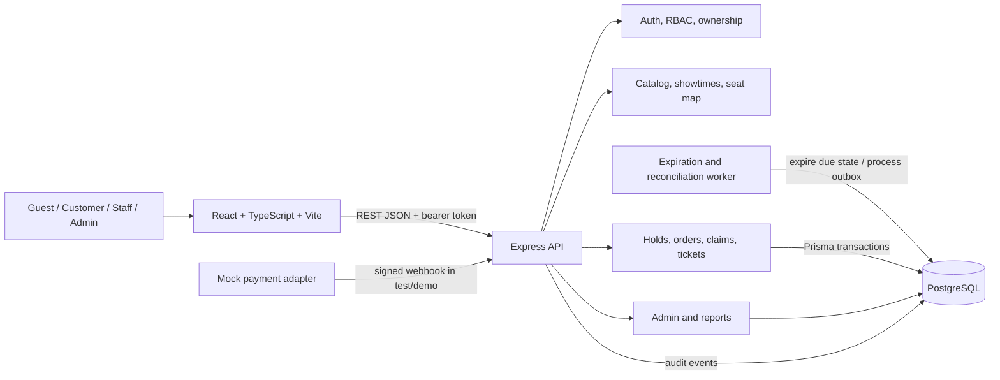
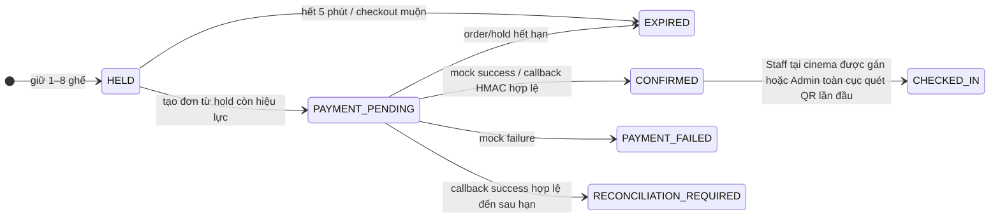

# Kiến trúc CinemaBooking

## 1. Phạm vi kiến trúc

Bản demo dùng React + TypeScript + Vite ở trình duyệt, Express + TypeScript làm REST API và PostgreSQL + Prisma làm nguồn dữ liệu cho tài khoản, claim ghế, đơn, thanh toán, vé và audit. Frontend không quyết định tình trạng ghế hoặc giá cuối. PostgreSQL transaction, khóa claim và ràng buộc unique bảo vệ các cập nhật cạnh tranh.



Bản demo có worker định kỳ để hết hạn hold/đơn đang chờ và xử lý outbox. Callback thành công hợp lệ đến sau expiry ghi một sự kiện idempotent; worker mở hồ sơ đối soát thủ công, không tự xác nhận đơn hoặc hoàn tiền. Hai worker process chạy đồng thời 60 giây và graceful restart catch-up đã được diễn tập trên PostgreSQL riêng; live hold TTL 300 giây cũng đã được xác nhận qua HTTP. Prolonged production soak, Redis, cổng thanh toán thật, recovery runbook và quy trình đối soát production vẫn chưa nằm trong evidence.

## 2. Mô hình dữ liệu

ERD dưới đây tóm tắt các model Prisma hiện có. Các quan hệ `0..1` biểu diễn FK tùy chọn hoặc record chưa được tạo; các unique key trọng yếu ghi sau diagram.

```mermaid
erDiagram
  USER {
    string id PK
    string email UK
    string passwordHash
    string role
    int authVersion
    string assignedCinemaId FK
  }
  CINEMA {
    string id PK
    string name
    string city
    string status
  }
  AUDITORIUM {
    string id PK
    string cinemaId FK
    string name
    string screenType
  }
  SEAT {
    string id PK
    string auditoriumId FK
    string label
    string row
    int column
    string type
    boolean isAccessible
  }
  MOVIE {
    string id PK
    string slug UK
    string title
    int runtimeMinutes
    string status
  }
  SHOWTIME {
    string id PK
    string movieId FK
    string auditoriumId FK
    datetime startAt
    datetime endAt
    int priceVnd
    int premiumSurchargeVnd
    string status
  }
  SEAT_HOLD {
    string id PK
    string userId FK
    string showtimeId FK
    datetime expiresAt
    string status
  }
  CINEMA_ORDER {
    string id PK
    string userId FK
    string showtimeId FK
    string holdId FK_UK
    int totalVnd
    string status
  }
  SEAT_CLAIM {
    string id PK
    string showtimeId FK
    string seatId FK
    string holdId FK
    string orderId FK
    int priceVnd
    datetime expiresAt
    string status
  }
  PAYMENT {
    string id PK
    string orderId FK_UK
    string providerEventId UK
    int amountVnd
    string status
  }
  PAYMENT_EVENT {
    string id PK
    string providerEventId UK
    string orderId FK
    string payloadHash
    string outcome
  }
  TICKET {
    string id PK
    string orderId FK
    string seatClaimId FK_UK
    string qrToken UK
    datetime checkedInAt
  }
  AUDIT_LOG {
    string id PK
    string actorId FK
    string action
    string entity
    string entityId
    datetime createdAt
  }
  OUTBOX_EVENT {
    string id PK
    string eventKey UK
    string eventType
    string aggregateId
    json payload
    string status
    int attempts
    datetime processedAt
  }
  RECONCILIATION_CASE {
    string id PK
    string providerEventId UK
    string orderId FK
    string outboxEventId FK_UK
    int amountVnd
    string currency
    string reason
    string status
  }

  CINEMA ||--o{ AUDITORIUM : contains
  CINEMA o|--o{ USER : assigned_staff
  AUDITORIUM ||--o{ SEAT : contains
  AUDITORIUM ||--o{ SHOWTIME : schedules
  MOVIE ||--o{ SHOWTIME : shown_as
  USER ||--o{ SEAT_HOLD : owns
  SHOWTIME ||--o{ SEAT_HOLD : held_for
  USER ||--o{ CINEMA_ORDER : owns
  SHOWTIME ||--o{ CINEMA_ORDER : booked_for
  SEAT_HOLD ||--o| CINEMA_ORDER : creates
  SHOWTIME ||--o{ SEAT_CLAIM : claims
  SEAT ||--o{ SEAT_CLAIM : claimed_as
  SEAT_HOLD o|--o{ SEAT_CLAIM : contains
  CINEMA_ORDER o|--o{ SEAT_CLAIM : orders
  CINEMA_ORDER ||--o| PAYMENT : pays
  PAYMENT ||--o{ PAYMENT_EVENT : records
  CINEMA_ORDER ||--o{ TICKET : issues
  SEAT_CLAIM ||--o| TICKET : issues_for
  CINEMA_ORDER ||--o{ RECONCILIATION_CASE : may_need_review
  OUTBOX_EVENT ||--o| RECONCILIATION_CASE : creates
  USER o|--o{ AUDIT_LOG : acts
```

Các ràng buộc quan trọng: email và movie slug duy nhất; auditorium name duy nhất trong một cinema; seat label và `(auditoriumId,row,column)` duy nhất; `(showtimeId,seatId)` duy nhất cho `SeatClaim`; `CinemaOrder.holdId`, `Payment.orderId`, `PaymentEvent.providerEventId`, `Ticket.seatClaimId`, `Ticket.qrToken`, `OutboxEvent.eventKey`, `ReconciliationCase.providerEventId` và `ReconciliationCase.outboxEventId` duy nhất. Expired/released claim được cập nhật và tái sử dụng cho cùng seat/showtime, không tạo lịch sử claim thứ hai.

## 3. State machine đặt vé

Diagram mô tả luồng nghiệp vụ tổng hợp; trạng thái thực được lưu ở `SeatHold`, `CinemaOrder`, `SeatClaim`, `Payment` và `Ticket`, không phải một enum duy nhất.



Khi xác nhận, payment/order/hold được cập nhật, claim chuyển `SOLD`, và mỗi claim tạo tối đa một ticket trong transaction idempotent. Khi thất bại hoặc hết hạn, claim được giải phóng. Callback đúng chữ ký nhưng đến sau expiry trả `409 PAYMENT_TOO_LATE`, order hết hạn, payment mang trạng thái `RECONCILIATION_REQUIRED`, không tạo vé và không chiếm lại ghế đã được cấp cho người khác. Sự kiện outbox dùng khóa từ provider event ID; worker chỉ tạo hồ sơ `OPEN` để người vận hành xử lý, không tự hoàn tiền. Vé đã check-in có `checkedInAt`; lượt sau bị từ chối. Hủy/hoàn tiền tự động vẫn ngoài phạm vi demo.

## 4. Payment sequence

```mermaid
sequenceDiagram
  actor Customer
  participant UI as Browser UI
  participant API as Express API
  participant DB as PostgreSQL
  participant Gateway as Mock provider / test callback

  Customer->>UI: Chọn suất, ghế và xác nhận giữ
  UI->>API: POST /api/holds (bearer, seatIds)
  API->>DB: Transaction: lock/check claim, calculate server price, create hold
  DB-->>API: holdId, expiresAt, totalVnd
  API-->>UI: Hold + TTL + total
  Customer->>UI: Tiếp tục checkout
  UI->>API: POST /api/orders {holdId}
  API->>DB: Lock hold; verify owner/status/expiry; snapshot claim price
  DB-->>API: PAYMENT_PENDING order
  API-->>UI: Order summary

  alt Customer dùng thanh toán demo
    UI->>API: POST /api/payments/mock/complete {orderId,outcome}
  else Callback test/mock provider
    Gateway->>API: POST /api/payments/mock/webhook + x-mock-signature
    API->>API: Validate schema and HMAC-SHA256
  end

  API->>DB: Lock order; dedupe eventId; verify amount/currency and claim TTL
  alt Hold còn hiệu lực và payment thành công
    API->>DB: Confirm order/payment/hold; mark claims SOLD; upsert one ticket per claim
    DB-->>API: Confirmed order + QR tickets
    API-->>UI: Success result
  else Payment thất bại
    API->>DB: Mark PAYMENT_FAILED; release claims; write event/audit
    API-->>UI: Error; no ticket
  else Callback thành công đến sau expiry
    API->>DB: Mark order/hold/claims EXPIRED; record event; no ticket
    API-->>Gateway: 409 PAYMENT_TOO_LATE
  else Signature hoặc amount sai
    API-->>Gateway: 401/422; không xác nhận order
  end
  UI->>API: GET /api/orders/me
  API-->>UI: Lịch sử order/ticket của Customer
```

Event id duy nhất và payload hash hỗ trợ retry idempotent; cùng event/payload trả lại kết quả cũ, còn dùng lại event ID cho payload khác bị từ chối. Browser redirect không phải bằng chứng thanh toán; kết quả chỉ đến từ API/mock callback.

## 5. Quyết định thiết kế và ranh giới

| Chủ đề | Quyết định hiện tại | Lý do/giới hạn |
|---|---|---|
| Múi giờ | Giao diện/ngày nghiệp vụ dùng `Asia/Ho_Chi_Minh`; timestamps lưu UTC | Tránh lệch ngày khi lọc suất chiếu |
| Tiền và giá | VND số nguyên; server tính giá theo claim và lưu snapshot vào claim/order | Client không quyết định tổng tiền; retry không làm đổi snapshot |
| Hold | Tối đa 8 ghế cùng suất, TTL 5 phút do backend tạo | Browser chỉ hiển thị countdown; DB/API quyết định expiry |
| Concurrent seat claim | PostgreSQL transaction/row lock + unique `(showtimeId,seatId)`; xử lý conflict `409` | Database là nguồn sự thật, không phụ thuộc frontend hay queue một process |
| Payment | Mock adapter; demo API và HMAC-SHA256 webhook; không nhận/lưu dữ liệu thẻ | Không phải tích hợp cổng thanh toán hoặc chứng minh tuân thủ payment thật |
| Idempotency | Khóa order/event và unique event ID; callback cùng payload không nhân đôi ticket | Xử lý retry/callback đồng thời an toàn trong phạm vi test |
| Quyền | Customer chỉ xem đơn mình; Staff chỉ check-in tại cinema được gán (không gán thì bị từ chối); Admin quản trị và check-in toàn cục | Follow-up API 20/20 kiểm tra hai route check-in, Staff assigned/unassigned/cross-cinema và Admin global; TC-SEC-03 kiểm tra ownership order/ticket/QR giữa hai Customer |
| Lịch suất | Cùng auditorium phải có ít nhất 20 phút giữa endAt và startAt của hai suất kế tiếp | Follow-up API 20/20 kiểm tra POST/PATCH; khoảng gap dưới 20 phút bị từ chối, gap đúng 20 phút khi tạo được chấp nhận |
| Backup/restore | PostgreSQL custom-format dump rồi restore vào database UTF8 từ template0 | Rehearsal PostgreSQL 17 đạt 27/10/2026; chưa kiểm thử lịch backup, PITR, RPO/RTO hay production restore |
| Báo cáo | Revenue cộng payment `SUCCEEDED`; occupancy là `SeatClaim.SOLD` trên tổng capacity của suất `ACTIVE` trong kỳ (mặc định chỉ suất chưa bắt đầu) | Công thức được ghi trong API và đối chiếu bằng integration test |
| P1/P2 | Promotion/refund/cancel, loyalty, notification, recommendation và cổng thật chưa bật | Cắt phạm vi để giữ P0; không mô tả là đã triển khai |

Cutoff đặt/hủy/hoàn, chính sách phân loại độ tuổi, quy định pháp lý, production staging budget và production operational/recovery plan vẫn cần phê duyệt trước khi vận hành thật. Restore rehearsal PostgreSQL 17/UTF8 đã chạy lại sau migrations mới; chưa có evidence cho lịch backup/PITR/RPO/RTO production. Coverage 100%, mutation 81.82% và k6 local Docker QA 50 VU/5 phút có evidence; mutation rerun trên source hiện tại đạt 81.82%. Full regression local đạt API 26/26, worker-process 1/1 và browser 40/40; focused expanded authorization matrix đạt 7/7 trên ba file với PostgreSQL cô lập. Native ZAP scans có kết quả local riêng; Compose DAST không có report pass và Docker Engine hiện dừng sau lỗi HTTP 500 trong scan. Worker process 60-second soak/restart và live 300-second hold-TTL được xác minh local; opt-in five-minute worker soak chưa chạy. Manual accessibility, prolonged reliability và exhaustive ASVS/BOLA review vẫn còn mở.
